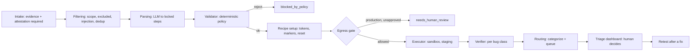

# DeSlop

**A self-hosted gatekeeper for self-managed Vulnerability Disclosure Programs (VDP) and bug bounty programs.**

DeSlop helps security teams survive the flood of AI-generated "slop" reports. It
filters, deduplicates, and — most importantly — *reproduces* incoming reports so
that a human only reviews submissions that already come with evidence.

> DeSlop makes **recommendations**. Final decisions (accept, reject, bounty)
> always belong to a human.


## The problem

Self-managed VDP programs drown in low-quality reports. LLMs make it cheap to
produce convincing-looking writeups that do not actually reproduce. Human
triagers burn out. DeSlop adds friction at intake and proof at triage: every
accepted-looking report is replayed against a staging environment, and a
deterministic verifier decides whether the bug is real.

## Core principles

- Recommendations and evidence, never automatic rejection. A report that fails
  reproduction is **deprioritized**, never closed.
- Reproduction is **locked** to the steps written in the report. No improvising,
  no alternative approaches.
- Proof comes from **deterministic per-bug-class verifiers**, never from an LLM's
  judgment.
- Self-hosted and privacy-first: runs fully locally with no outbound calls
  required (`llm_provider=none`, local `bge-m3` embeddings).
- Generic: no company names, scopes, or rules hardcoded. Everything is config.
- Not a full VDP platform. It filters and reproduces; it does not do researcher
  accounts, long threads, or disclosure management.

## How it works



Key separations:

- The **parser** (LLM) reads untrusted report text and produces structured JSON.
  It has no execution access.
- The **validator** is deterministic code. It rejects out-of-scope or destructive
  steps before anything runs.
- The **executor** never reads raw report text; it only runs locked steps.
- The **verifier** decides `proven` / `not_proven` / `inconclusive` / `error` from
  technical evidence only.

## Quickstart

```bash
pip install -e .                 # or: pip install -r requirements.txt
docker compose up -d             # Postgres + pgvector, web app, OOB listener
```

Then open **http://localhost:8000** — a first-run **setup wizard** appears. It
creates your admin account, your first program, and writes the config. Nothing to
edit by hand.

Prefer the CLI?

```bash
deslop init                      # generate .env with secrets + dashboard password
```

For the intentionally vulnerable lab targets:

```bash
docker compose -f lab/docker-compose.yml up -d
```

### HTTPS (optional)

```bash
DESLOP_DOMAIN=vdp.example.com docker compose --profile https up -d
```

Caddy obtains and renews a Let's Encrypt certificate automatically. See
`deploy/`.

## CLI

```bash
deslop init                                     # generate .env (secrets + dashboard password)
deslop config list                              # list configured programs
deslop config show acme-cloud                   # print a program's config
deslop dataset generate --out data/ds.jsonl     # synthetic eval dataset
deslop doctor lab                               # environment readiness checklist
deslop eval lab                                 # run the eval harness
deslop demo --program dvwa                      # sort a mixed batch (Arsenal demo)
deslop serve --init-db                           # web app: form, status page, dashboard
deslop retest <program> <report_id>             # re-run reproduction after a fix
```

## Operational features

- **Structured intake** — the submission form requires reproduction steps plus
  at least one technical artifact (raw HTTP request, HAR, or PoC), a
  self-reproduction attestation, and an optional AI-assistance disclosure. A
  deterministic per-class evidence checklist (e.g. SSRF → OOB callback, IDOR →
  two accounts) turns gaps into follow-up questions for the researcher.
- **Production gate** — plans targeting in-scope production hosts (not mapped to
  staging) stop at `needs_human_review` until a triager records
  `approve_production`; nothing is sent before that.
- **Program canary** — plant a unique token in staging and mark bug classes that
  should surface it; a missing canary is flagged to the reviewer.
- **First-run setup wizard** — configure admin account, first program, and
  model/listener from the browser. No manual `.env` editing.
- **One-command CLI setup** — `deslop init` writes a `.env` with strong secrets.
- **Modern, minimalist UI** — clean triage dashboard, submission form, and status
  page (server-rendered, no build step).
- **Notifications** — Slack webhook and/or Telegram bot on new reports and status
  changes (`DESLOP_NOTIFY_ENABLED`, `DESLOP_SLACK_WEBHOOK_URL`, ...).
- **Intake anti-abuse** — per-IP submission rate limiting and an email/IP
  blacklist with temporary blocks (`data/blacklist.json`), on top of the evidence
  requirement that already filters slop.
- **Deterministic CVSS v3.1** — an exact calculator that runs in the pipeline and
  is exposed at `/dashboard/cvss?vector=...`, as a second opinion to any LLM
  suggestion.
- **Multi-user dashboard** — roles `admin`, `triager`, `readonly` via
  `DESLOP_DASHBOARD_USERS_JSON`; read-only accounts see no mutating actions.
- **HTTPS** — optional Caddy profile with automatic Let's Encrypt certificates.
- **Logging** — plain or JSON logs, with size-based rotation (`DESLOP_LOG_FILE`).

## Configuration

- **Environment** (`DESLOP_*`, see `.env.example`): database URL, LLM/embedding
  provider, sandbox limits, SMTP, OOB listener. The LLM provider is your choice:
  `anthropic`, `openai` (any OpenAI-compatible endpoint), `ollama` (local), or
  `none`.
- **Per-program YAML** (`config/programs/*.yaml`): scope, excluded classes,
  staging host map, test accounts, bounty table, reply templates, status-page
  settings, `allowed_egress_hosts`, `allow_production`, `canary`, and
  `evidence_requirements`. Scope and egress entries accept URLs or
  `*.domain` globs — they are normalized to host patterns at load
  (`*.example.com` covers subdomains only; list the apex as a separate
  `domain` entry). See `config/programs/example-acme-cloud.yaml`.

## Recipes and verifiers (v1)

| Bug class | Proof criterion |
|---|---|
| IDOR | An object owned by account A appears, with its owner-specific data, in a response returned to account B. |
| XSS (reflected/stored) | The payload's unique marker actually executes in a headless browser. |
| SSRF | A callback carrying a unique per-run token reaches the self-hosted OOB listener. |
| Open redirect | The browser, or a 3xx `Location`, points at the marker domain. |
| OS command injection | The response contains the output of an executed OS command (e.g. `id`). |

Bug classes without a recipe are routed to `manual_reproduction_required`. See
`CONTRIBUTING.md` to add one.

## Lab targets

`lab/docker-compose.yml` brings up intentionally vulnerable targets:

- **custom-app** (18000): IDOR, reflected/stored XSS, SSRF, open redirect.
- **DVWA** (14000): MariaDB-backed, security level `low`; reflected XSS and OS
  command injection. Config in `config/programs/dvwa.yaml`.
- **OWASP Juice Shop** (13000).
- **OOB listener** (18080) for blind bugs.

```bash
docker compose -f lab/docker-compose.yml up -d
deslop demo --program dvwa     # proves DVWA XSS + command injection
```

## Eval results

Run against the intentionally vulnerable lab, synthetic dataset (`seed=1337`,
local models, no LLM):

```
| Provider | Routing acc. | Repro rate | False reproduced | Dup precision | Dup recall | Injection blocked |
|----------|--------------|------------|------------------|---------------|------------|-------------------|
| none     | 70.27%       | 40.00%     | 0                | 100.00%       | 100.00%    | 3/3               |
```

- **False reproduced: 0** — the safety target. No non-reproducible report was
  ever marked proven.
- **Injection blocked: 3/3** — every prompt-injection attempt was caught and
  routed to human review.
- `repro rate` is capped here by the offline parser (client-side XSS and
  token-based SSRF need the LLM parser or a live browser); it rises with a real
  model configured.

`deslop eval` exports this table as markdown for the README.

## Layout

```
src/deslop/
  config/     settings + per-program YAML schema and loader
  db/         SQLAlchemy models (pgvector on Postgres, JSON on SQLite)
  llm/        provider abstraction, embeddings, prompts, validated client
  parser/     LLM step parser + offline raw-HTTP parser
  repro/      step model, scope, validator, substitution, web executor
  intake/     per-class evidence checklist (deterministic gap detection)
  recipes/    recipe/verifier plugins (IDOR, XSS, SSRF, open redirect)
  pipeline/   orchestrator, filters, routing, retest
  dedup/      normalization, retrieval, judgement
  eval/       metrics + eval runner
  web/        FastAPI app: submission form, status page, triage dashboard
  oob/        self-hosted out-of-band listener
lab/          intentionally vulnerable targets (custom app, Juice Shop, OOB)
config/       example program configs
docs/         architecture, setup, threat model
```

## Security model

Report content is **untrusted input**. It is delimited in prompts, treated as
data, and scanned for prompt injection. The sandbox is a single-use container
with egress restricted to in-scope staging hosts and the OOB listener — the same
allowlist is enforced per-request by the executor. Credentials
are redacted from logs and evidence packs. Reproduction against in-scope
production hosts requires explicit approval (env flag, program flag, or a
per-report `approve_production` decision) and is gated before any request is
sent. See `docs/threat-model.md`.

## Limitations

- v1 ships only the web executor. Mobile/desktop executors are interface stubs.
- Verifiers are only as good as their proof criteria; a bug with no recipe is
  never auto-proven.
- The offline parser (no LLM) is conservative and will under-reproduce
  client-side bugs; configure an LLM for full coverage.
- DeSlop is **not** a full VDP platform.

## Liability

This tool executes HTTP requests and drives a headless browser against targets
you configure. **Only use it against infrastructure you own or are explicitly
authorized to test.** You are responsible for how you deploy it.

## License

Placeholder — to be finalized as Apache-2.0 or AGPL-3.0. See `LICENSE`.
