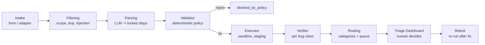
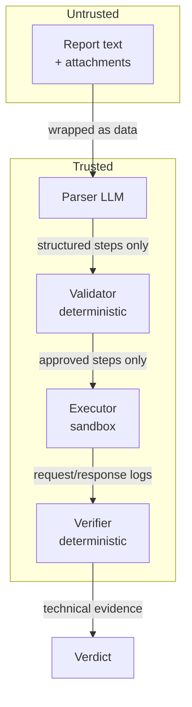
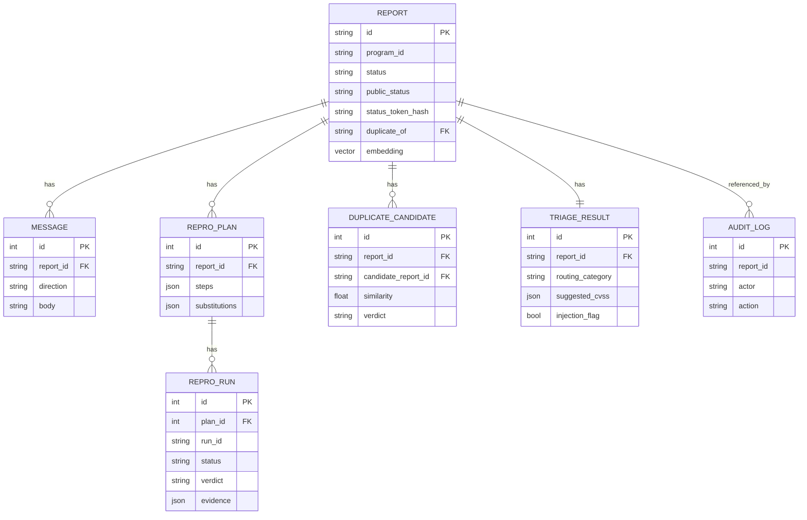
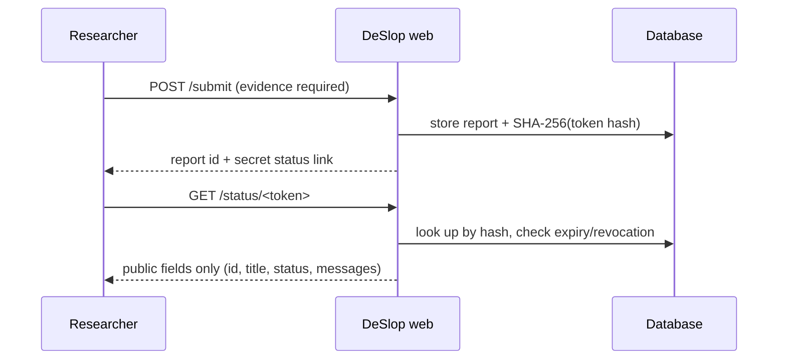

# Architecture

This document evolves with the build. Stage 1 covers the data model and config
loader; later stages fill in the pipeline.

## High-level pipeline



## Trust boundaries



Key rule: the **executor never reads raw report text**, and the **LLM never
decides whether a bug is proven**.

## Data model (Stage 1)



The `embedding` column maps to `pgvector` on PostgreSQL and to JSON on SQLite,
so the same models run in production and in tests.

## Configuration model

- **Environment** (`DESLOP_*`, see `.env.example`) — infrastructure concerns:
  database URL, LLM/embedding provider, sandbox limits, SMTP, OOB listener.
- **Per-program YAML** (`config/programs/*.yaml`) — all policy: scope, excluded
  classes, staging host map, test accounts, bounty table, reply templates,
  status-page settings.

No company names, scopes, or rules are hardcoded.

## Executor / verifier plugin interfaces

The core (intake, dedup, parsing, validator, routing, evidence) is independent of
how a plan is executed or verified.

```python
class Executor(Protocol):
    name: str
    def execute(self, plan, program, *, run_id) -> ExecutionResult: ...

class Verifier(Protocol):
    bug_class: str
    def verify(self, plan, execution, program) -> VerificationResult: ...
```

v1 ships `WebExecutor` (httpx). A recipe bundles state setup, execution (via an
executor), and a verifier. Adding a bug class means writing a verifier and
registering a recipe; adding an executor (Android on-device, desktop) means
implementing `Executor` without touching the core.

## Routing categories

| Category | Meaning |
|---|---|
| `reproduced` | Proven by a verifier; high-priority human review. |
| `reproduced_with_deviation` | Proven after triager-approved deviations. |
| `needs_info` | Steps incomplete; a draft question for the researcher is prepared. |
| `failed_replay` | Failed at a specific step; low-priority queue, still human-reviewed. |
| `manual_reproduction_required` | No recipe for the bug class yet. |
| `out_of_scope` / `excluded_class` / `duplicate` | With reasoning and references. |
| `blocked_by_policy` | Steps violate policy or injection was detected. |

No status automatically rejects or closes a report. Internal statuses are never
shown to researchers.

## Status-page token flow



Tokens are random (>=128 bits), stored hashed, expiring, and revocable. The
public status only changes when a triager makes a decision or sends a message.
