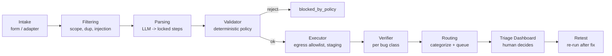
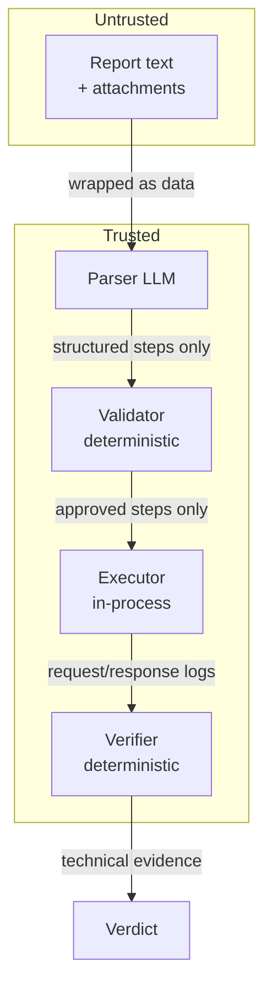
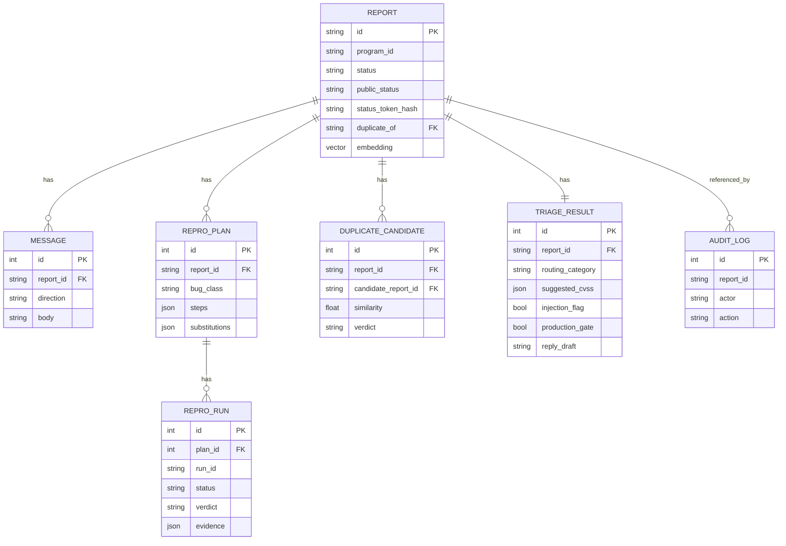
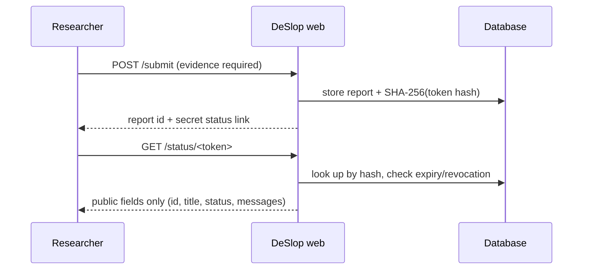

# Architecture

How the pieces fit together. The pipeline order below is authoritative; the
known gaps at the end list where reality is still behind the design.

## High-level pipeline



## Trust boundaries



Key rule: the **executor never reads raw report text**, and the **LLM never
decides whether a bug is proven**.

## Data model



The `embedding` column maps to `pgvector` on PostgreSQL and to JSON on SQLite,
so the same models run in production and in tests.

## Configuration model

- **Environment** (`DESLOP_*`, see `.env.example`) — infrastructure concerns:
  database URL, LLM provider, execution limits, SMTP, OOB listener.
- **Per-program YAML** (`config/programs/*.yaml`) — all policy: scope, excluded
  classes, staging host map, test accounts, bounty table, reply templates,
  status-page settings.

No company names, scopes, or rules are hardcoded.

## Executor / verifier plugin interfaces

The core (intake, dedup, parsing, validator, routing, evidence) is independent of
how a plan is executed or verified.

```python
class Executor(Protocol):
    name: str
    def execute(
        self, plan, program, *, run_id=None, egress: EgressPolicy | None = None
    ) -> ExecutionResult: ...

class Recipe(Protocol):
    bug_class: str
    def setup(self, program, *, run_id) -> SetupResult: ...
    def verify(
        self, plan, execution, program, *, setup_data=None
    ) -> VerificationResult: ...
```

v1 ships `WebExecutor` (httpx). A recipe bundles state setup, execution (via an
executor), and a verifier. `setup()` runs before every execution — it is what
generates the per-run OOB token (SSRF) — and its output reaches `verify()` as
`setup_data`. IDOR ownership markers come from trusted program configuration
(`test_accounts[].owned_markers`, an owned `canary`), never from the report.
Adding a bug class means writing a verifier and registering a recipe; adding
an executor (Android on-device, desktop) means implementing `Executor` without
touching the core.

### Pipeline order (authoritative)

1. Injection scan (scope-aware: a fetch aimed at an in-scope host or a known
   OOB callback host is a normal reproduction step; plan-manipulation phrasing
   and out-of-scope fetches are always flagged).
2. Scope check on the declared asset/endpoint. Scope entries accept URL-shaped
   values — they are normalized to host patterns at load; `*.example.com`
   covers subdomains only (list the apex separately as `domain`).
3. Excluded bug class check.
4. Evidence checklist: per-class deterministic requirements (e.g. SSRF needs an
   OOB callback address, IDOR needs two accounts). Gaps become reviewer notes
   and `needs_info` questions — never an auto-reject.
5. Metadata duplicate check against persisted embeddings.
6. LLM/offline parsing into a locked plan.
7. Post-parse duplicate check (merged with the metadata candidates).
8. Deterministic plan validation (scope per step, no destructive steps).
9. `recipe.setup()` + optional staging `reset` endpoint call.
10. Whitelisted substitutions (host map, credentials, per-run OOB token, and —
    for open redirect — external redirect targets pointed at DeSlop's marker
    domain).
11. Egress gate: every target host must be permitted by the egress policy;
    in-scope production hosts additionally require an approval (setting,
    program flag, or per-report `approve_production` decision) — otherwise the
    report is queued as `needs_human_review` with `production_gate` set.
12. Execution + deterministic verification.
13. Routing to a queue for a human decision.

## Routing categories

| Category | Meaning |
|---|---|
| `reproduced` | Proven by a verifier; high-priority human review. |
| `reproduced_with_deviation` | Proven after triager-approved deviations. |
| `needs_info` | Steps incomplete; a draft question for the researcher is prepared. |
| `failed_replay` | Failed at a specific step; low-priority queue, still human-reviewed. |
| `manual_reproduction_required` | No recipe for the bug class yet. |
| `out_of_scope` / `excluded_class` / `duplicate` | With reasoning and references. |
| `blocked_by_policy` | Steps violate policy or injection was detected. |
| `needs_human_review` | E.g. the plan targets an in-scope production host and awaits an `approve_production` decision. |

No status automatically rejects or closes a report. Internal statuses are never
shown to researchers.

## Status-page token flow



Tokens are random (>=128 bits), stored hashed, expiring, and revocable. The
public status only changes when a triager makes a decision or sends a message.

## Known gaps

- The executor runs inside the web process. There is no container and no
  network-level isolation; the egress policy compares hostnames only.
- Duplicate detection uses `HashingEmbedder` (hashed tokens) in the live path
  (`web/service.py`, `pipeline/orchestrator.py`). `llm.embeddings.build_embedder`
  and the `DESLOP_EMBEDDING_*` settings exist but nothing calls them.
- `deslop doctor` is not consulted by the pipeline.
- The pipeline runs as a FastAPI background task in the web process after
  `POST /submit` has stored the report (`web/service.process_report`). There is
  no queue or worker: a restart mid-run leaves the report in `received`, and
  `deslop reprocess` picks those up again.
- The CVSS suggestion on a report is heuristic (report keywords plus a per-class
  baseline); only `/dashboard/cvss` is an exact calculator.
